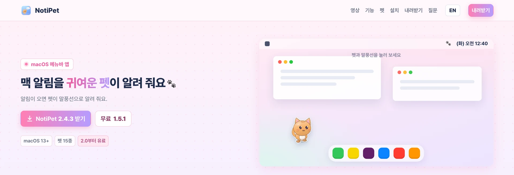
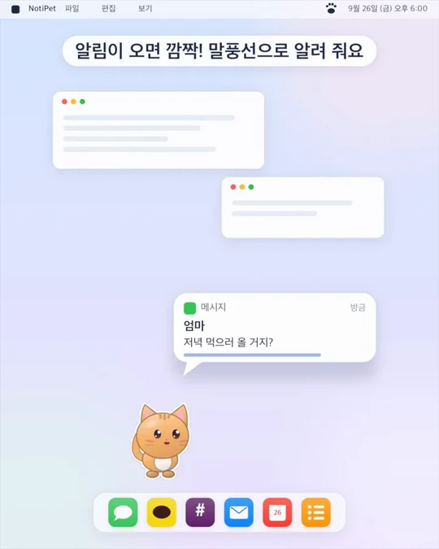
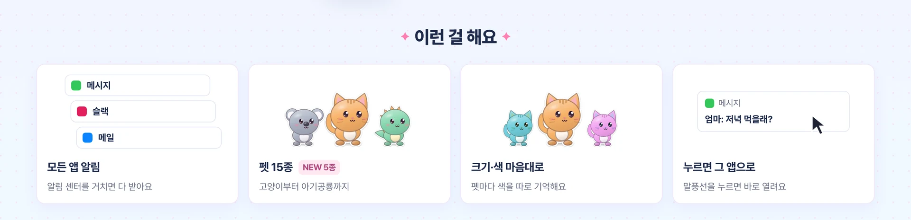
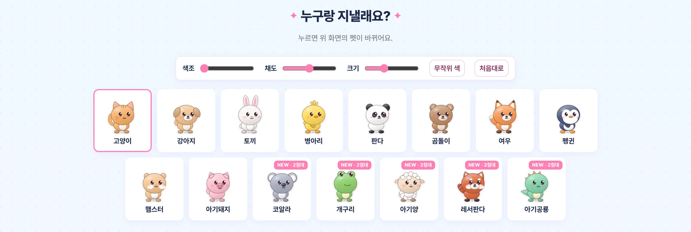
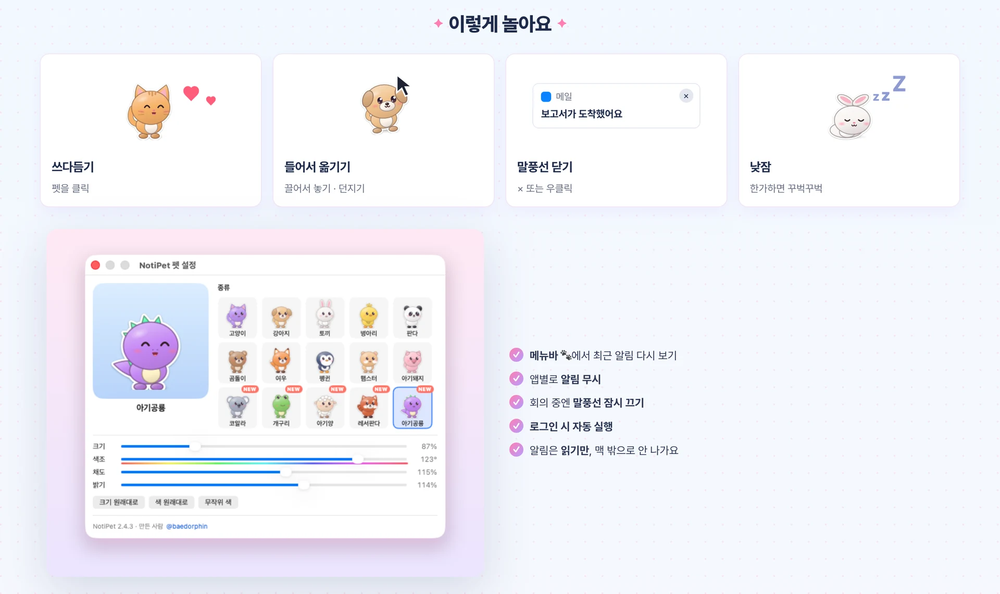
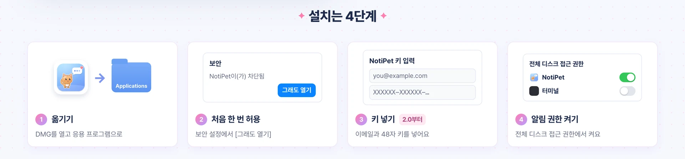
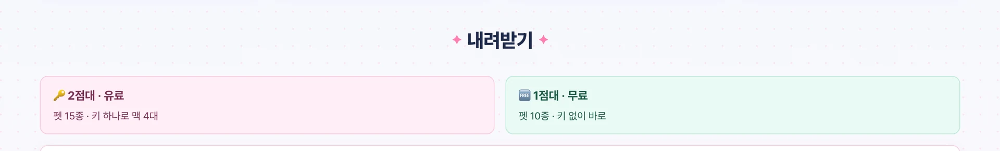
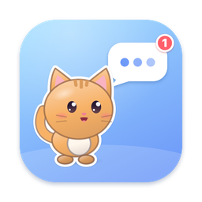

  

  
  
  
  

<b>알림이 오면 펫이 말풍선으로 알려 줘요.</b> · <a href="https://notipet.sanghak.kr/en/">English</a>

   
  <a href="https://notipet.sanghak.kr/#video">▶ 30초 영상 보기</a>

<a href="https://notipet.sanghak.kr/#buy"><b>🛒 구매 신청은 홈페이지에서</b></a> · 이메일로 키를 보내 드려요

## 📦 버전별 내려받기

| 버전 | 가격 | 바뀐 점 | 내려받기 |
| :-- | :-- | :-- | :-- |
| **2.4.3** (최신) | 🔑 유료 · 키 필요 | **알림 올 때 네온 춤** · 앱 두 번 실행 막기 | [NotiPet-2.4.3.dmg](https://github.com/sanghakbae/Noti-Pet/releases/download/v2.4.3/NotiPet-2.4.3.dmg) |
| 2.4.2 | 🔑 유료 · 키 필요 | **말풍선 가독성** · 업데이트 안내를 업데이트할 때까지 다시 | [NotiPet-2.4.2.dmg](https://github.com/sanghakbae/Noti-Pet/releases/download/v2.4.2/NotiPet-2.4.2.dmg) |
| 2.4.1 | 🔑 유료 · 키 필요 | **키 하나로 맥 4대까지** · 처음 켤 때 이 맥을 등록해요 | [NotiPet-2.4.1.dmg](https://github.com/sanghakbae/Noti-Pet/releases/download/v2.4.1/NotiPet-2.4.1.dmg) |
| 2.4.0 | 🔑 유료 · 키 필요 | **자동 업데이트** · 새 버전이 나오면 펫이 알려 주고 눌러서 바로 업데이트 | [NotiPet-2.4.0.dmg](https://github.com/sanghakbae/Noti-Pet/releases/download/v2.4.0/NotiPet-2.4.0.dmg) |
| 2.3.0 | 🔑 유료 · 키 필요 | **CPU 사용량 크게 줄임** (약 55% → 8%) | [NotiPet-2.3.0.dmg](https://github.com/sanghakbae/Noti-Pet/releases/download/v2.3.0/NotiPet-2.3.0.dmg) |
| 2.2.0 | 🔑 유료 · 키 필요 | **새 펫 5종**: 코알라·개구리·아기양·레서판다·아기공룡 (펫 15종) | [NotiPet-2.2.0.dmg](https://github.com/sanghakbae/Noti-Pet/releases/download/v2.2.0/NotiPet-2.2.0.dmg) |
| 2.1.0 | 🔑 유료 · 키 필요 | 키가 구매자 이메일에 묶여요. 입력 창에서 이메일과 키를 함께 넣어요 | [NotiPet-2.1.0.dmg](https://github.com/sanghakbae/Noti-Pet/releases/download/v2.1.0/NotiPet-2.1.0.dmg) |
| **1.5.1** (무료 최신) | 🆓 무료 | **말풍선 가독성** · 업데이트 안내 반복 | [NotiPet-1.5.1.dmg](https://github.com/sanghakbae/Noti-Pet/releases/download/v1.5.1/NotiPet-1.5.1.dmg) |
| 1.5.0 | 🆓 무료 | **자동 업데이트** · 1점대 안에서만 올라가요 | [NotiPet-1.5.0.dmg](https://github.com/sanghakbae/Noti-Pet/releases/download/v1.5.0/NotiPet-1.5.0.dmg) |
| 1.4.0 | 🆓 무료 | **CPU 사용량 크게 줄임** (약 55% → 10% 안팎) | [NotiPet-1.4.0.dmg](https://github.com/sanghakbae/Noti-Pet/releases/download/v1.4.0/NotiPet-1.4.0.dmg) |
| 1.3.0 | 🆓 무료 | 토끼 귀·병아리 깃털 끝이 잘려 보이던 문제를 고쳤어요 | [NotiPet-1.3.0.dmg](https://github.com/sanghakbae/Noti-Pet/releases/download/v1.3.0/NotiPet-1.3.0.dmg) |
| 1.2.0 | 🆓 무료 | 첫 공개 · 펫 10종, 펫 설정 창(종류·크기·색) | [NotiPet-1.2.0.dmg](https://github.com/sanghakbae/Noti-Pet/releases/download/v1.2.0/NotiPet-1.2.0.dmg) |

구매 신청과 내려받기는 **[notipet.sanghak.kr](https://notipet.sanghak.kr/)** 에서도 할 수 있어요. 모든 버전과 바뀐 내용은 [Releases](https://github.com/sanghakbae/Noti-Pet/releases)에서 볼 수 있어요.

모든 버전과 바뀐 내용은 [Releases](https://github.com/sanghakbae/Noti-Pet/releases)에서 볼 수 있어요.

## 🙋 자주 묻는 질문

<b>키는 어떻게 받아요?</b>
 

[구매 신청](https://notipet.sanghak.kr/#buy)에 이메일을 남겨 주세요. 그 이메일 전용 키를 보내 드려요. 앱에 이메일과 키를 함께 넣어요.

<b>무료로 쓸 수 있나요?</b>
 

1점대는 키 없이 무료예요(펫 10종). 새 펫 5종은 2점대에만 있어요.

<b>키 하나로 맥 몇 대까지?</b>
 

맥 4대까지 쓸 수 있어요. 안 쓰는 맥에서 메뉴 🐾 › **이 맥 등록 해제**를 누르면 자리가 비어요.

<b>말풍선이 조금 늦게 떠요</b>
 

배너보다 약 5초 늦어요. macOS가 알림을 저장하는 시간이라 정상이에요.

<b>배너랑 말풍선이 둘 다 떠요</b>
 

배너는 macOS가 띄워서 못 꺼요. 알림 설정에서 스타일을 **없음**으로, **알림 센터에 표시**는 켜 두세요.

<b>권한을 켜도 필요하대요</b>
 

전체 디스크 접근 권한 목록에서 −로 뺐다가 +로 추가한 뒤 NotiPet을 껐다 켜 주세요.

<b>업데이트는 어떻게 해요?</b>
 

새 버전이 나오면 펫이 알려 줘요. 말풍선을 누르면 저절로 바뀌어요. 1점대는 1점대 안에서만 올라가요.

<b>지우려면요?</b>
 

메뉴 › 종료 → 휴지통으로 옮기고, 전체 디스크 접근 권한 목록에서도 −로 빼 주세요.

---

   
  <b>NotiPet</b> · macOS 13+ · Apple 실리콘 / Intel 
  만든 사람 <a href="https://www.threads.com/@baedorphin">@baedorphin</a> · <a href="https://github.com/sanghakbae/Noti-Pet/issues">의견 보내기</a> · <a href="https://notipet.sanghak.kr/">notipet.sanghak.kr</a>

